# Chafer Interceptor 2.0 Spray Pack

**Farming Simulator 25 mod by MModding**

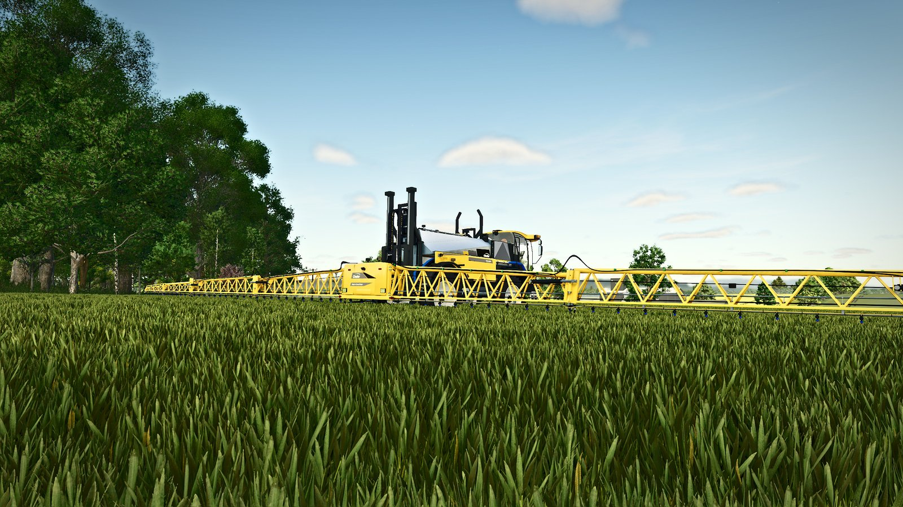

The Chafer Interceptor 2.0 self-propelled sprayer, with a spray shed and a water tank to keep it filled: three shop items in one mod. Store your product in the shed, park by the tank, and fill the sprayer at its induction hopper.

## Download

Get **FS25_ChaferSprayPack.zip** from [Releases](https://github.com/FS-MModding/FS25_ChaferSprayPack/releases). Put it, still zipped, in `Documents/My Games/FarmingSimulator2025/mods`, then tick the pack in the mod list when you load your savegame.

You also need **Interactive Control** (FS25_interactiveControl) to open the workstation and lower the induction hopper.

The green **Code** button downloads this page's files, not the mod.

## How to use it

The step-by-step guide is in **[TUTORIAL.md](TUTORIAL.md)**, and as a PDF in [Releases](https://github.com/FS-MModding/FS25_ChaferSprayPack/releases).

Filling the sprayer, in short:

1. Put pallets of product in the shed's chemical store.
2. Park the sprayer within 60 m of the shed, next to the water tank.
3. Open the workstation and lower the induction hopper.
4. On the hopper screen, choose the product and the amount (or a field), then press **INDUCT**.
5. Connect the water tank's hose and press **ADD WATER**. The water stops by itself when the mix is right (20 % product, 80 % water).

## In the shop

| Item | Shop | Price |
| --- | --- | --- |
| Chafer Interceptor 2.0 | Sprayers | 199,000 |
| Spray Shed with Chemical Store | Sheds | 64,000 |
| Water Tank 15,000 l with Hose | Water tanks | 6,800 |
| Chemical cartons pallet, herbicide | Pallets | 620 |
| Chemical cartons pallet, liquid fertiliser | Pallets | 800 |

Sprayer options: 30 m boom +8,000, 36 m boom +16,000, PWM nozzle control +6,500, and the Topcon X35 or AgraGPS screen. The brands on the cartons are made up.

## What it does

### Chafer Interceptor 2.0

- **Tank and boom:** 5,000 l stainless steel tank and a G-Series triple-fold boom: 24, 30 or 36 m.
- **Engine and drive:** 240 hp Deutz TCD 6.1, hydrostatic drive, up to 50 km/h; front-wheel, all-wheel and crab steering.
- **Boom:** automatic levelling and boom suspension. The boom drops to working height as it unfolds.
- **Cab:** New Holland FR780 cab with a working Chafer DI4 terminal and Topcon X35 screen. AgraGPS can run on the Topcon screen (needs FS25_AgraGPS).
- **Induction hopper:** its own fill screen. Choose the product and the amount, or a field in the field calculator, then INDUCT, ADD WATER, WATER NOW or BUY. It mixes 20 % product to 80 % water and the water stops by itself.
- **Every spray product:** herbicide, liquid fertiliser and spray products from other mods.
- **Workstation:** RinsePro display and a clean clothing locker.
- **21 Interactive Control points:** workstation, hopper, lockers, toolbox, cab door, engine hood, steering column and the cab switches.
- **Details:** access steps that fold up when you drive off, reversing camera, LED work lights, detailed engine bay, air suspension, dirt and wear.
- **Sounds:** Deutz engine, hydrostatic drive, pump and nozzles, boom fold knocks and the air compressor.

### Spray Shed with Chemical Store

- Room for the sprayer with its boom folded (4.8 m wide door).
- Chemical store for 3 pallets, with a storage point outside to take them back out.
- Working main door, store door and store shutter; light switches, and floodlights at night.
- Building dirt and moss; it gets wet in the rain and snow settles on the roof.

### Water Tank 15,000 l with Hose

- Refills itself from the mains at the water price; a stopcock turns it off.
- 15 m hose that couples itself at the tank or at the sprayer's fill port, then runs 600 l per minute into any vehicle that takes water.
- Level gauge and info box.

## Screenshots

| | |
| --- | --- |
| 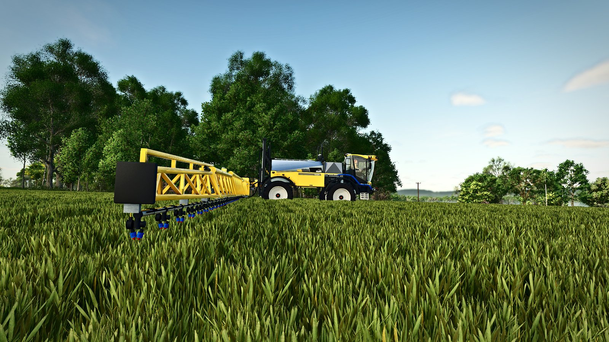 | 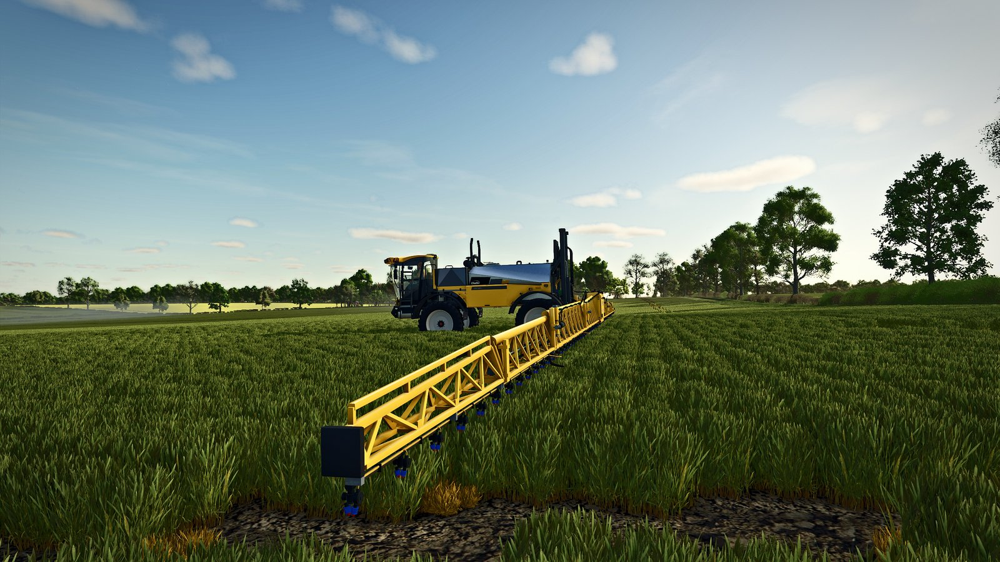 |
| 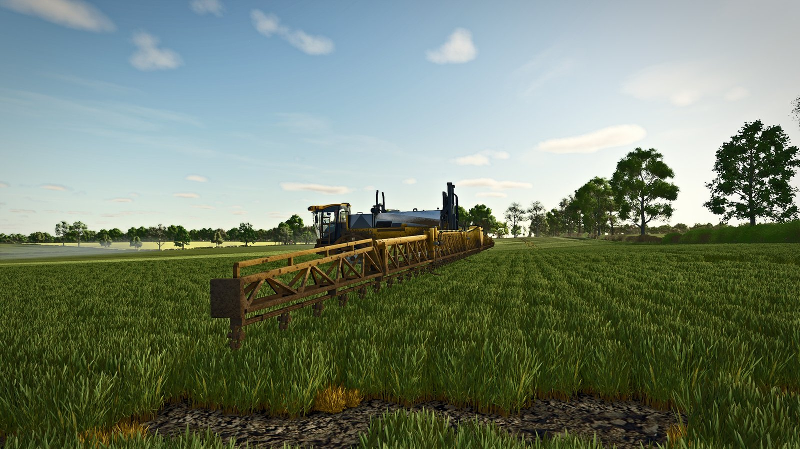 | 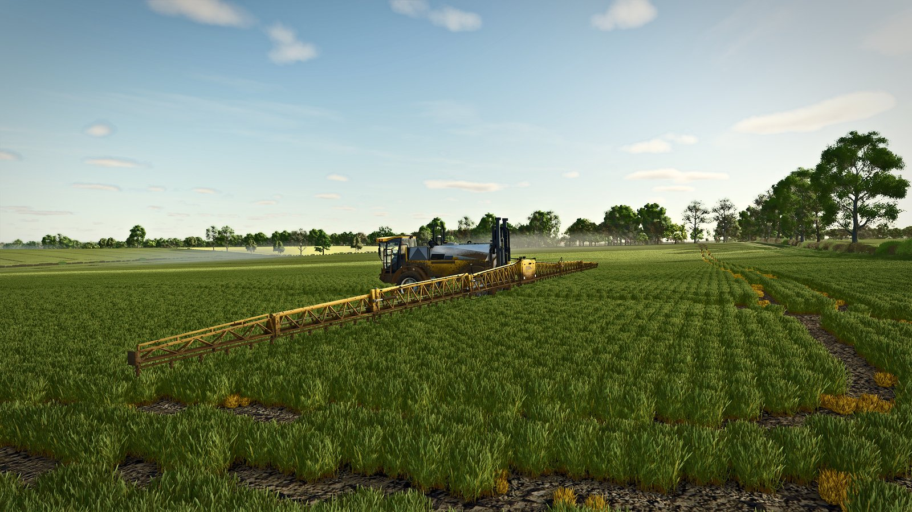 |
| 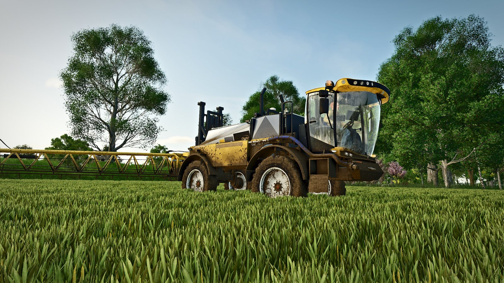 | 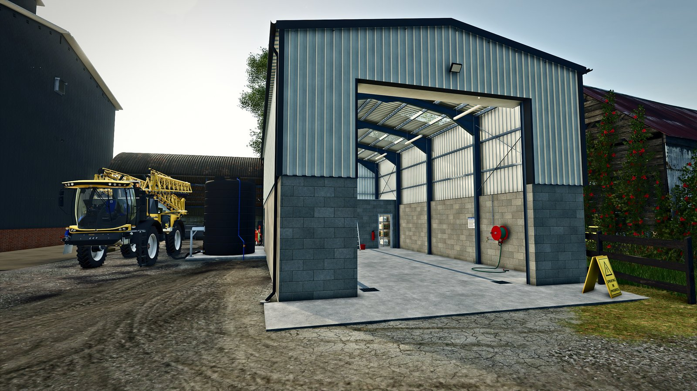 |
| 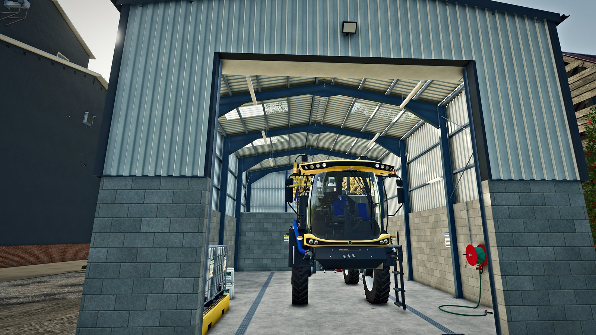 | 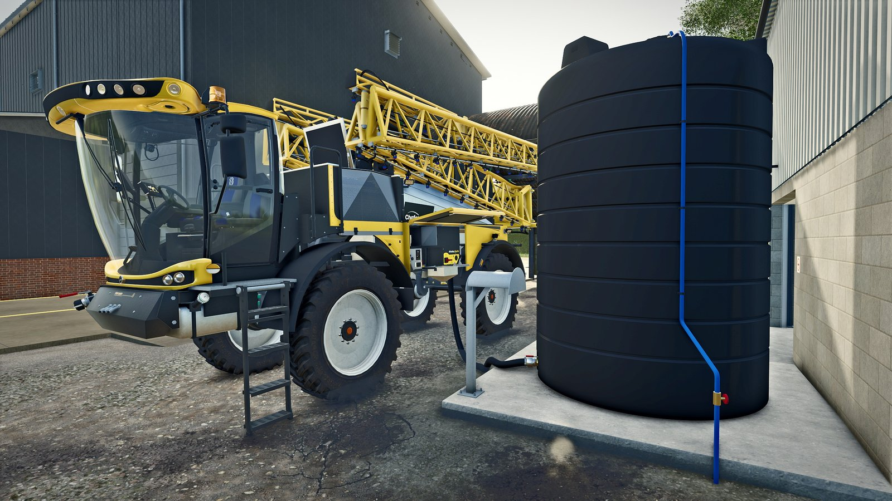 |
| 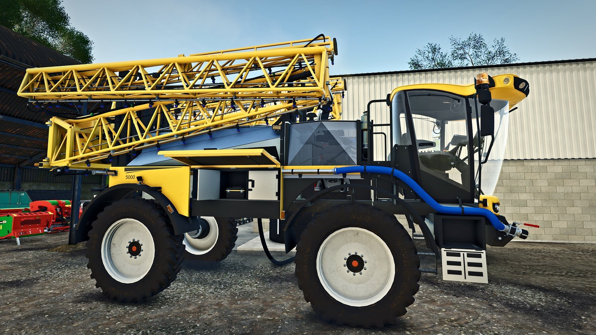 | 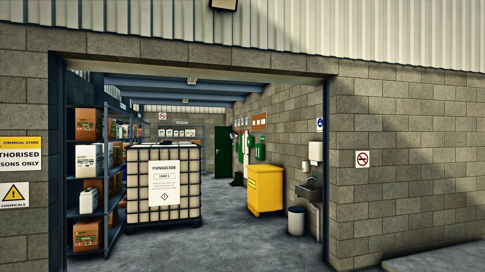 |
| 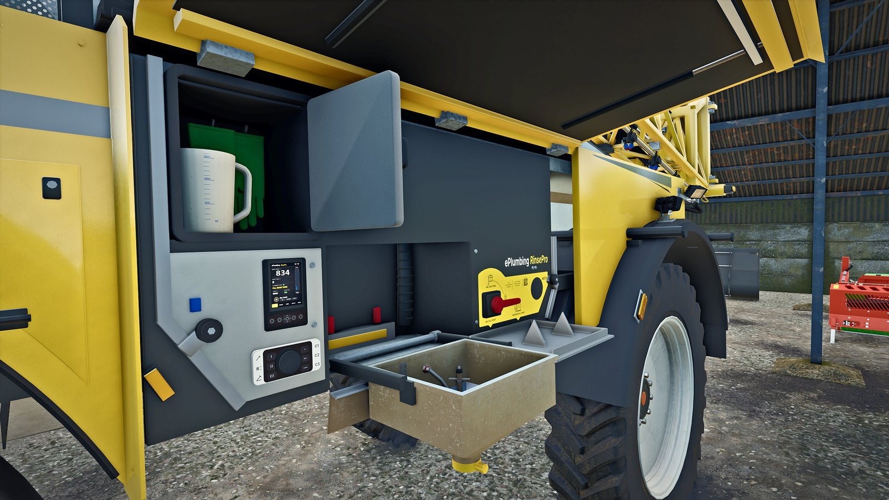 | 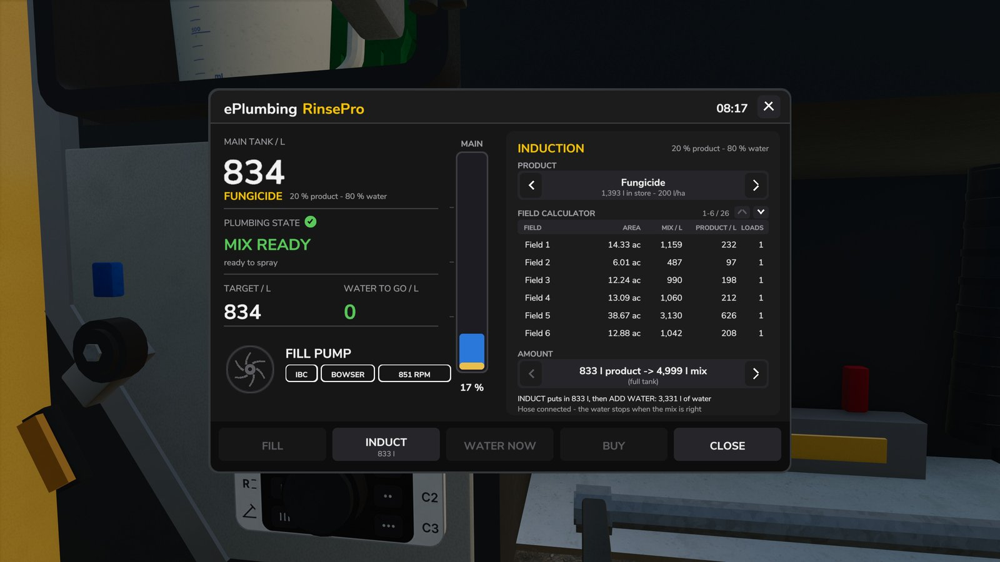 |
| 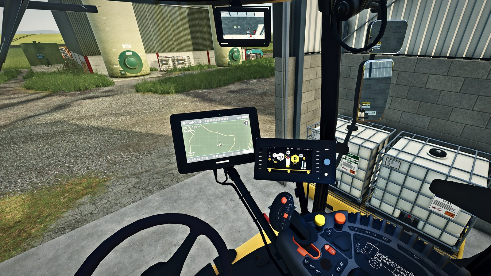 | 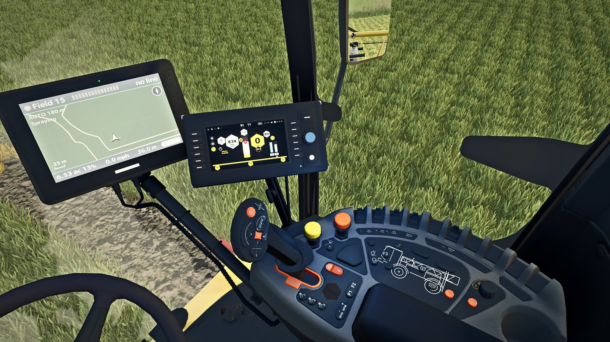 |
| 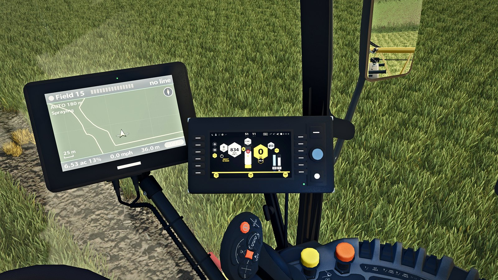 | |

## Works with

- **Interactive Control** (FS25_interactiveControl) by VertexDezign: needed for the workstation, the hopper, the doors and the cab switches. Without it the sprayer still fills at normal fill points.
- **AgraGPS** (FS25_AgraGPS) by Guner348: optional, for the AgraGPS screen.
- Multiplayer.

## Reporting a bug

1. The pack writes to the game's log, `Documents/My Games/FarmingSimulator2025/log.txt`. Its lines start with `[ChaferInduction]`, `[ChaferHopperRinse]`, `[ChaferAccessSteps]` or `[FarmWaterTank]`. Copy the log before you start the game again, because the game starts a new one each time.
2. [Open a bug report](https://github.com/FS-MModding/FS25_ChaferSprayPack/issues/new/choose) and drag log.txt into it. Screenshots help too.

## Changelog

See [CHANGELOG.md](CHANGELOG.md).

## Credits

- Model, textures and scripts: MModding
- Interactive Control: VertexDezign (separate mod, not included)
- AgraGPS: Guner348 (separate mod, optional, not included)
- Wheels, hubs, sounds and shared textures: Farming Simulator 25 (GIANTS Software)

Chafer, Deutz, New Holland and Topcon are trademarks of their owners. This is a fan-made mod, not made or endorsed by them.
