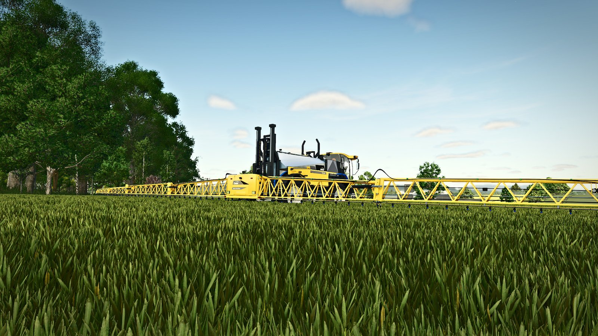
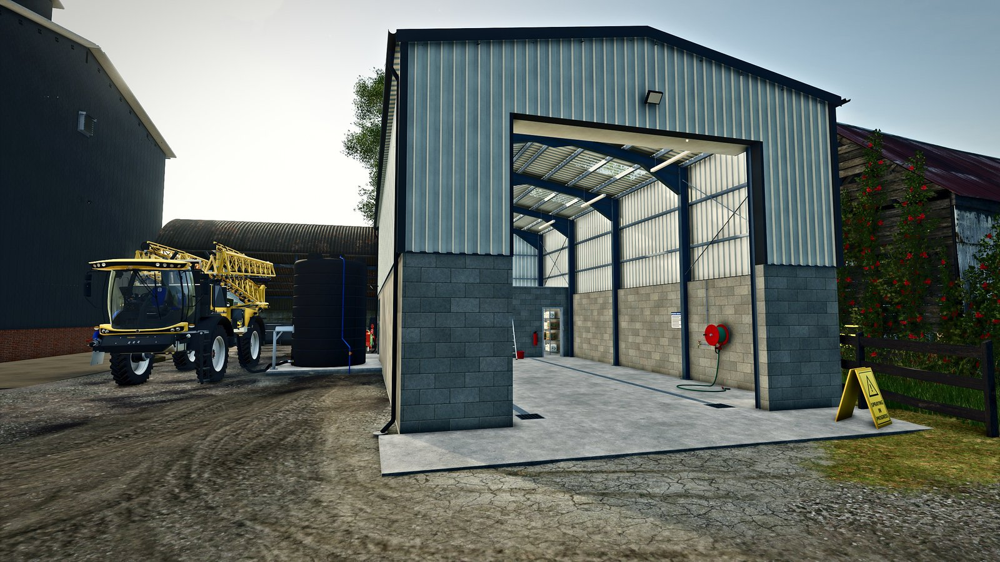
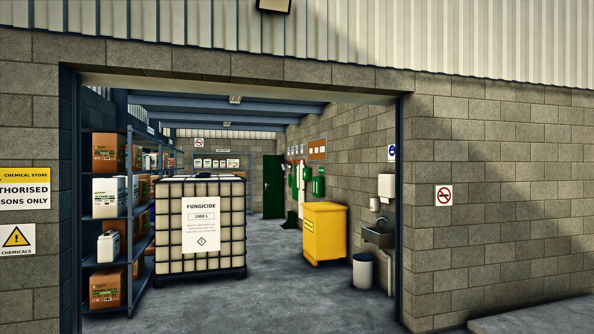
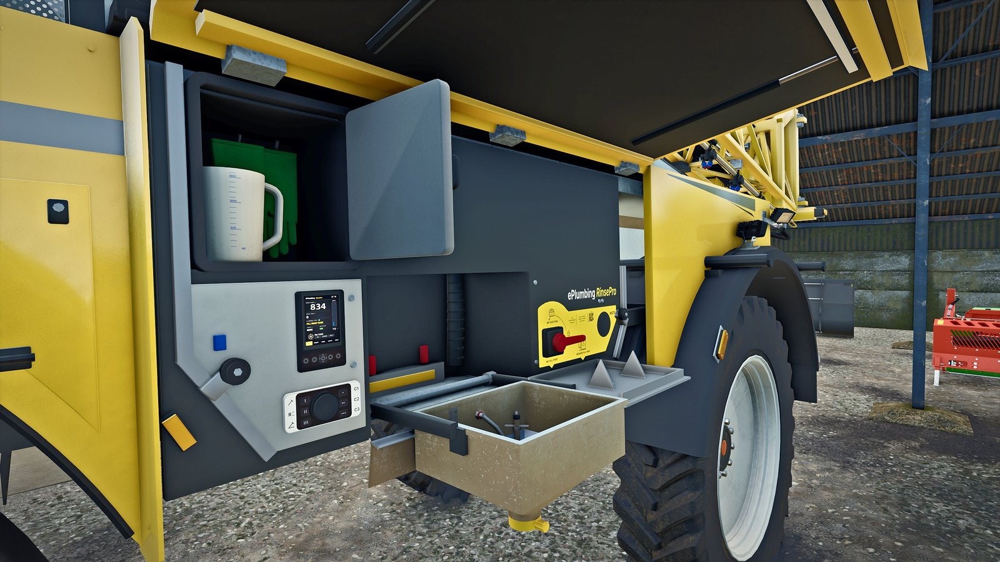
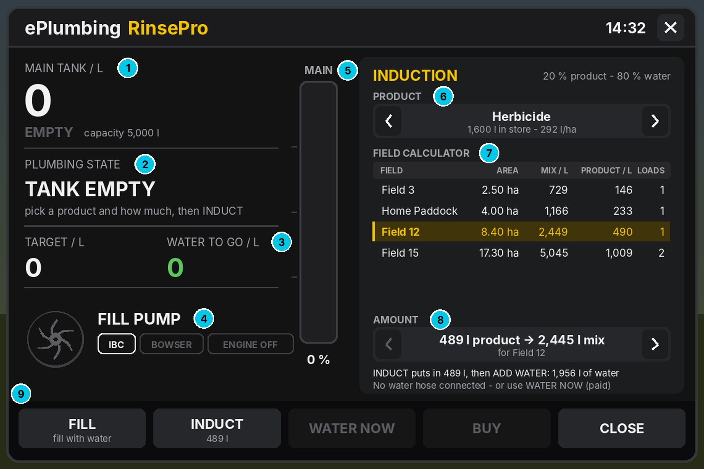
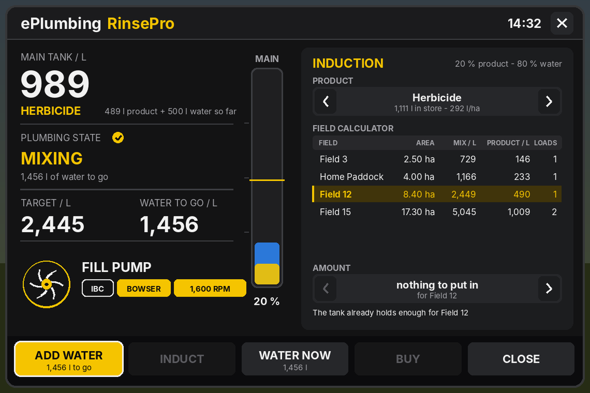
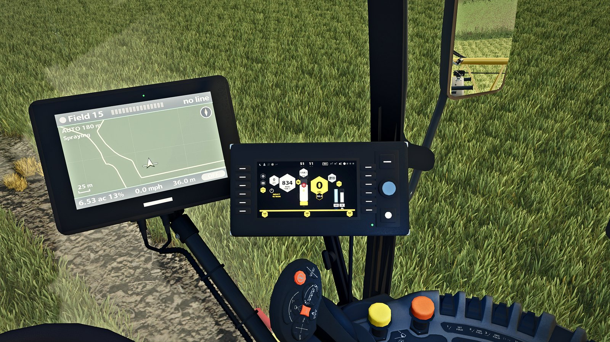
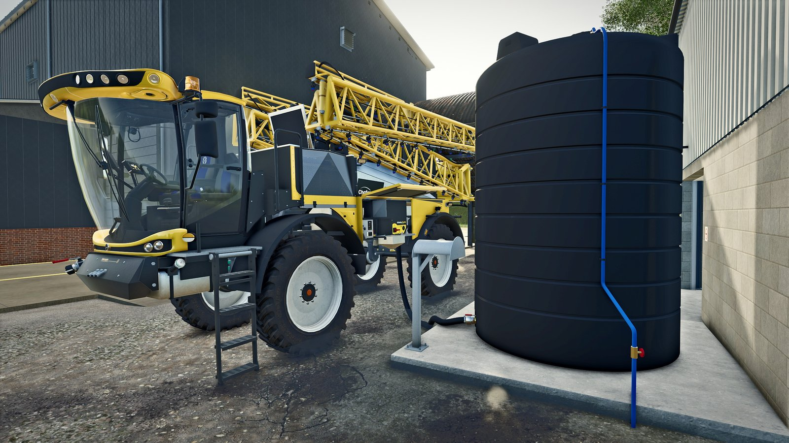

# Chafer Spray Pack: Tutorial

*By MModding*

Filling takes four steps: store product in the shed, park by the water tank, INDUCT at the hopper, then ADD WATER through the hose. After that come driving and spraying, the Interactive Control points, and the shed and tank.

*The Chafer Interceptor 2.0 at work, boom unfolded.*

## What's in the pack and how to install it

One zip, **FS25_ChaferSprayPack.zip**, holds the sprayer, the shed and the water tank. They are built to work together: product comes from the shed, water from the tank, and both go in at the sprayer's induction hopper.

| Item                             | Shop                   | Price   | What it does                                                             |
|----------------------------------|------------------------|---------|--------------------------------------------------------------------------|
| Chafer Interceptor 2.0 (5,000 l) | Sprayers, brand Chafer | 199,000 | Self-propelled sprayer with the induction hopper and the RinsePro screen |
| Spray Shed with Chemical Store   | Sheds                  | 64,000  | Single-bay shed; the chemical store at the back keeps pallets of product |
| Water Tank 15,000 l with Hose    | Water tanks            | 6,800   | Mains-fed tank; its 15 m hose fills the sprayer at 600 l per game minute |

1.  Download **FS25_ChaferSprayPack.zip** from [Releases](https://github.com/FS-MModding/FS25_ChaferSprayPack/releases) and put it in `Documents/My Games/FarmingSimulator2025/mods`. Leave it zipped.

2.  If you used the separate mods (FS25_ChaferInterceptor2, FS25_SprayShed, FS25_FarmWaterTank), take them out of the mods folder. Two copies of the same scripts clash.

3.  Install **Interactive Control** (FS25_interactiveControl) as well. You need it to open the workstation and lower the induction hopper.

4.  Tick the pack in the savegame's mod list and start the game.

**Savegame note:** anything bought from the separate mods does not carry over by itself. The game drops those machines and buildings, and the pallets in the shed, once the old mods are gone. Back up the savegame before you switch.

The pack works in multiplayer, because it is a zip.

## Setting up the yard

Put the shed and the water tank close to where you fill: the sprayer draws product from stores within 60 m, and the hose reaches 15 m.

*A yard set up for filling: the spray shed, with the water tank and the Interceptor beside it.*

| Distance | What it limits                                                                   |
|----------|----------------------------------------------------------------------------------|
| 60 m     | Pallet stores the sprayer takes product from, and the water tanks WATER NOW uses |
| 15 m     | Reach of the water tank's hose                                                   |
| 1.8 m    | How close you stand to the hopper to open its screen                             |

1.  **Place the Spray Shed** (Sheds). The chemical store is the block-built room at the back.

2.  **Place the Water Tank** (Water tanks) beside your filling spot. It tops itself up from the mains at 6,000 l per game hour, charged at the water price. The red stopcock on the blue mains pipe turns the supply on and off.

3.  **Store your product.** Drive each pallet into the chemical store, through the green door or the side shutter, and set it down: it is stored and shows stacked on the shelves. Herbicide, liquid fertiliser and spray products from other mods all work.

4.  **Park the sprayer** within 60 m of the store, with its left side, where the workstation is, within 15 m of the water tank.

To take pallets back out, use the storage point outside the store's side shutter: they are set down on the loading apron.

*The chemical store, seen through its side shutter.*

## Opening the hopper and its screen

The screen only opens on foot, at the lowered induction hopper on the sprayer's left side.

1.  Walk to the workstation on the left of the machine. With Interactive Control, click the lid (**Open workstation**). The RinsePro display behind it lights up.

2.  Click the induction hopper (**Lower induction hopper**). It swings down and the flap under it drops out of the way.

3.  Stand at the hopper. The prompt tells you the state, for example *Fill sprayer from the spray shed* or *Induction hopper (the mix needs 1,956 l of water)*.

4.  Press the activate key. The RinsePro screen opens and the mouse pointer appears.

Close the screen with **CLOSE**, the X at the top right, or Esc. Before you drive off, click the hopper again (**Stow induction hopper**) and close the workstation.

*The open workstation: induction hopper lowered, clean clothing locker above it, RinsePro display on the left.*

## The screen at a glance

The left half is the machine's RinsePro display, live; the right half is where you choose what goes in. The numbers match the picture at the end of this section.

| \#  | Part                 | What it shows                                                                                                                                                     |
|-----|----------------------|-------------------------------------------------------------------------------------------------------------------------------------------------------------------|
| 1   | MAIN TANK / L        | Litres in the tank, what it holds (empty, water or the product) and a mix's product and water so far                                                              |
| 2   | PLUMBING STATE       | What the plumbing is doing. Green tick = ready, yellow = working, orange ! = needs you                                                                            |
| 3   | TARGET / WATER TO GO | What the tank will hold once the water is in, and the water still to come                                                                                         |
| 4   | FILL PUMP            | Turns while water or product goes in. IBC lights when product is in store, BOWSER when the hose is on (yellow while water flows), the third chip shows engine rpm |
| 5   | MAIN gauge           | Blue = tank contents, yellow at the bottom = the product in it, yellow line = the target level                                                                    |
| 6   | PRODUCT              | The product to put in, its stock in the store and its rate in l/ha                                                                                                |
| 7   | FIELD CALCULATOR     | Your farm's fields with area, mix, product and tank loads; click one to fill for it                                                                               |
| 8   | AMOUNT               | How much product goes in, and two lines saying what INDUCT will do                                                                                                |
| 9   | Soft keys            | The actions below                                                                                                                                                 |

| Key       | What it does                                                                                                 |
|-----------|--------------------------------------------------------------------------------------------------------------|
| FILL      | Water into an empty tank, or onto plain water, through the hose until the tank is full or you press it again |
| ADD WATER | FILL becomes this while a mix waits for its water: runs in exactly the water needed, then stops              |
| INDUCT    | Puts the chosen amount of product in from the store                                                          |
| WATER NOW | Adds the mix's water at once from your water tanks within 60 m, mains for the rest, paid                     |
| BUY       | Turns the plain water in the tank into the chosen product, at the product's price                            |
| CLOSE     | Closes the screen                                                                                            |

**Mouse:** click keys, arrows and field rows. The wheel changes the product or amount under the pointer and scrolls the field list.

**Keyboard and gamepad:** up and down move between product, fields, amount and keys; left and right change the value or the key; Enter or A presses; Esc or B closes.

*Ready to INDUCT 489 l of herbicide for Field 12. The numbers match the table above.*

## Mixing a tank, step by step

Product goes in first, then the water: the mix is 20 % product to 80 % water, so every litre of product takes 4 litres of water.

1.  **Pick the product** with the arrows under PRODUCT. A product you have stored shows *x l in store*.

2.  **Pick how much.** Click a field in the field calculator, and the amount switches to what that field needs. Or step through the amounts: the first is a full tank (or all you have in store), then 20 l upwards.

3.  **Check the two lines under AMOUNT.** For example: *INDUCT puts in 489 l, then ADD WATER: 1,956 l of water*.

4.  **Press INDUCT.** The product comes out of the store, part-used pallets first, and the hopper rinses it in. The water stays off, so you can press INDUCT again to add more.

5.  **Connect the hose.** Stand at the water tank's valve or hose post, or at the bowser fill port right of the hopper, and press the activate key. The hose runs out and couples, and BOWSER lights up on the screen.

6.  **Press ADD WATER.** It has a yellow outline while the mix waits. Water runs in at 600 l per game minute, the key counts down the litres to go and the engine holds 1,600 rpm.

7.  **Wait for MIX READY.** The water stops by itself when the mix is right, and a message gives the totals.

8.  **Close up and go.** Close the screen, stow the hopper, close the workstation and drive off. Press the activate key at the coupling to put the hose away, or just drive out of its reach.

The sprayer will not switch on while the mix still needs water. A mix waiting for water is kept when you save.

*ADD WATER running: the product is in, 1,456 l of water to go to the 2,445 l mix, and the pump holds 1,600 rpm.*

## The field calculator

The calculator lists every field your farm owns, by field number, and works out the mix each one takes at the selected product's rate.

- **Rate:** the litres of mix the machine sprays per hectare, shown under PRODUCT. Herbicide is 292 l/ha (58 l of product), liquid fertiliser 259 l/ha. A mod product without a spray rate of its own uses the herbicide rate.

- **Columns:** AREA (in the game's unit, hectares or acres), MIX / L (area × rate), PRODUCT / L (20 % of the mix) and LOADS (5,000 l tanks).

- **Click a field** to fill for it: AMOUNT switches to *for Field 12*. Product already in the tank counts, so you only put in what is missing. Click the field again to drop it.

- **Big fields:** a field bigger than one tank fills a full tank first, and the line under AMOUNT says how many loads it takes.

- **Short of product:** the line under AMOUNT says how much is in store against what the field needs.

The rate assumes you spray at the machine's working speed. The game uses the same litres per second at any speed, so driving slower puts more on each hectare.

## Other ways to fill

The hose and ADD WATER are the normal route; these cover the rest.

- **WATER NOW:** adds all the water a mix needs at once, no hose. It comes from your water tanks within 60 m first, then the mains, charged at the water price.

- **Water first:** on an empty tank, FILL runs plain water in until the tank is full or you press FILL again. Product inducted afterwards mixes into that water. The amount list then offers *for the water in the tank*: the product that makes a 20 % mix with the water already there.

- **BUY:** with plain water in the tank, BUY turns all of it into the chosen product in one go, at the product's price less the water. The key shows the cost.

- **Engine revs:** whenever the fill pump runs, the engine holds 1,600 rpm. With the game's automatic motor start on, the engine starts by itself for filling and stops again afterwards.

- **List menu:** if the screen ever fails to open, the hopper falls back to the older list menu with the same actions, and log.txt gets a line starting \[ChaferInduction\] hopper screen:.

## Driving and spraying

The Interceptor drives at up to 50 km/h on the road and sprays at up to 25 km/h. Fold the boom before you take it on the road.

- **Screens:** on the right-hand pillar, the Chafer DI4 terminal shows speed, engine rpm, coolant and outside temperature, fuel and DEF, the main tank, the steering mode, park brake, neutral, cruise control and the spray pump. Beside it, the Topcon X35 shows speed and tank level, or AgraGPS if you chose that option and have FS25_AgraGPS installed.

- **Steering:** four modes: front-wheel, all-wheel, crab left and crab right. Switch with the game's steering mode key or the crab switch in the cab; the DI4 shows which one is on.

- **Boom:** 24, 30 or 36 m, chosen in the shop. Unfold it with the fold key or the fold switch in the cab. It drops to working height as it unfolds, then levels itself and rides on its suspension.

- **Spraying:** turn it on with the usual key or the spray pump switch in the cab. It only starts once the tank holds a product, and not while a mix still waits for its water.

- **Access steps:** the steps up to the cab fold away when you drive off and come back down when you get out.

- **Reversing camera:** while the engine runs, the screen at the top of the windscreen shows the view behind the machine, and a beeper sounds when you reverse.

*The Topcon X35 running AgraGPS (left) and the Chafer DI4 terminal (right).*

## Interactive Control points

With Interactive Control installed, 21 click points open, close and switch parts of the machine. Outside ones work on foot next to the machine; in the cab, bring up Interactive Control's pointer first.

| Click point           | Where                                   | What it does                                                                                                                                               |
|-----------------------|-----------------------------------------|------------------------------------------------------------------------------------------------------------------------------------------------------------|
| Workstation lid       | Left side                               | Opens and closes the workstation. It only closes with the hopper stowed and the clothing locker shut                                                       |
| Induction hopper      | Inside the workstation                  | Lowers and stows the hopper. Its screen only opens with the hopper down                                                                                    |
| Clean clothing locker | Inside the workstation                  | Opens and closes the PPE locker                                                                                                                            |
| Side locker           | Right side                              | Opens and closes the locker cover. It only closes with the tool cabinet inside shut                                                                        |
| Tool cabinet          | Inside the side locker                  | Opens and closes the cabinet                                                                                                                               |
| Toolbox               | Below the blue fill hose                | Opens and closes the toolbox                                                                                                                               |
| Cab door              | Outside and inside the door             | Opens and closes the door                                                                                                                                  |
| Engine hood           | Three points on the hood behind the cab | Opens and closes the hood, with the boom folded or not                                                                                                     |
| Steering column       | In the cab                              | Tilts the column forward and back                                                                                                                          |
| Cab switches          | In the cab                              | Spray pump, boom fold, cruise control, steering mode, auto-steer, lights, front and rear work lights, beacons, hazard lights, radio, engine start and stop |

Without Interactive Control the sprayer still fills at the usual fill points and from pallets, but the workstation stays shut, so the induction hopper and its screen are out of reach.

## The shed and the water tank

Both work on foot with the activate key; neither needs Interactive Control.

- **Doors:** the main roller shutter, the chemical store's green door and its side shutter each open and close when you stand at them and press the activate key.

- **Lights:** two switches turn on the shed lights and the chemical store light. The floodlights outside come on at night.

- **Chemical store:** takes 3 pallets of up to 2.6 x 2.6 x 2.4 m. The bay and the store count as indoors, so rain and snow stay out.

- **Carton pallets:** the shop sells pallets of herbicide (620) and liquid fertiliser (800), 24 cartons and 480 l each. The brands on the cartons are invented.

- **Info boxes:** walk into the shed or up to the tank to see its info box. The tank's shows whether the mains supply is on and where the hose is.

- **Water level:** the float in the clear column on the tank's side shows how full it is. The tank refills from the mains at 6,000 l per game hour, paid at the water price, while the red stopcock on the blue pipe is open.

- **Weather and dirt:** mud is splashed up the shed walls and the foot of the tank, rain streaks run down from the eaves, and moss and lichen grow on the roof. The shed and the tank's concrete pad get wet in the rain and take snow.

*Filling at the water tank: the hose runs from the tank's outlet to the fill port beside the induction hopper.*

## Troubleshooting

Most problems come down to distance, the hose, or a mix still waiting for its water.

| Problem                                                         | Fix                                                                                                             |
|-----------------------------------------------------------------|-----------------------------------------------------------------------------------------------------------------|
| Sprayer won't switch on: *the spray mix still needs x of water* | Press ADD WATER with the hose on, or WATER NOW                                                                  |
| Sprayer won't spray plain water                                 | INDUCT or BUY a product into it first                                                                           |
| No prompt at the hopper                                         | Open the workstation and lower the hopper (Interactive Control), stand within 1.8 m, and get out of any vehicle |
| *No sprayer products in a pallet store within 60 m*             | Park within 60 m of the shed, and set the pallets down inside the chemical store, not in the yard               |
| Product shows *not in store*                                    | Store a pallet of it, or BUY it into plain water                                                                |
| CONNECT WATER HOSE stays on                                     | Couple the hose; check the sprayer is within 15 m, the water tank isn't empty, and the mains stopcock is on     |
| *The tank holds Fungicide - only that product can go in*        | Spray the tank empty before you change product                                                                  |
| INDUCT greyed out                                               | Nothing in store, the tank is full, or it already holds enough for the chosen field                             |
| Hose put itself away                                            | The sprayer was full, the water tank ran dry, or you drove out of reach                                         |
| Engine doesn't start for filling                                | The game's automatic motor start is off; start the engine yourself                                              |
